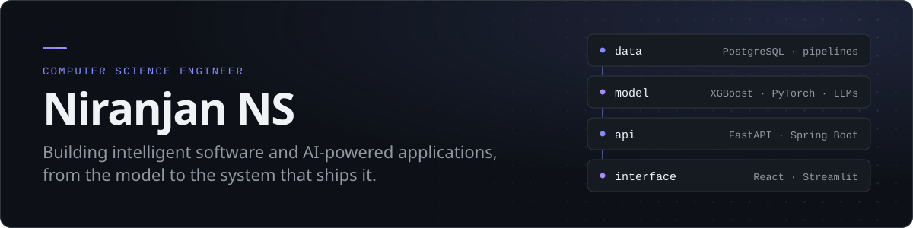
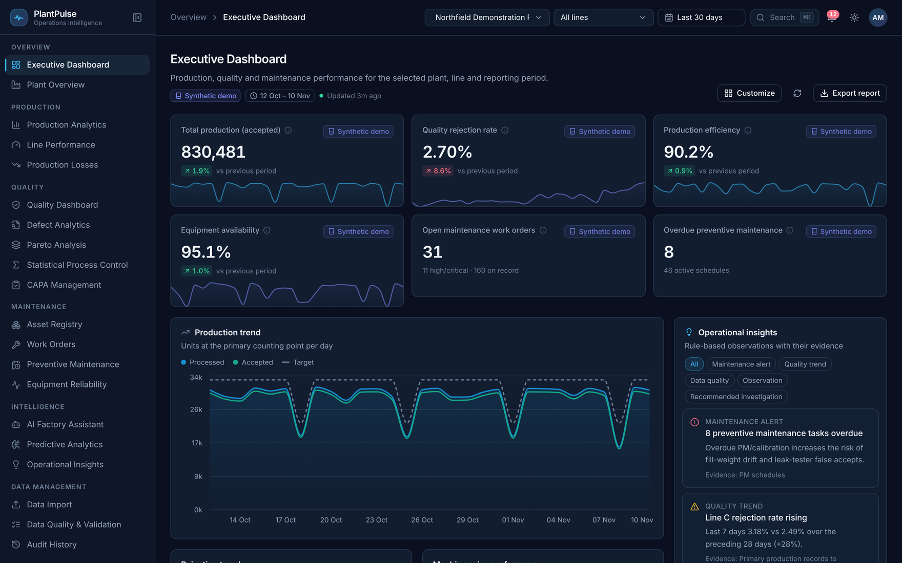
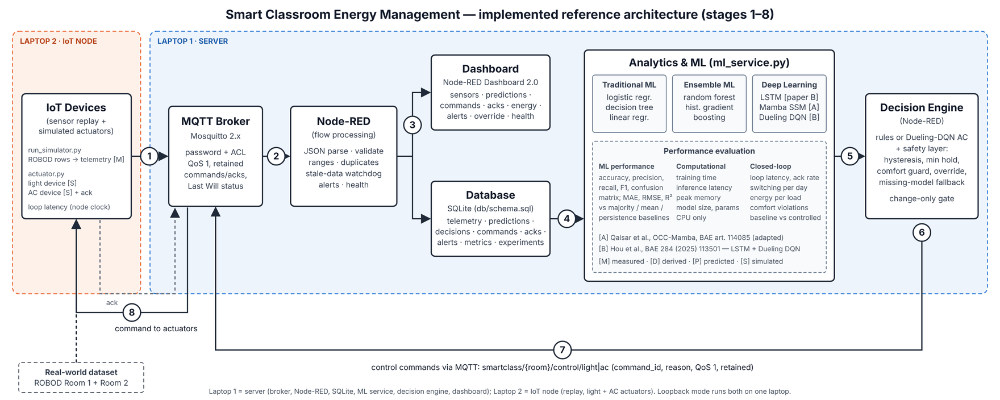
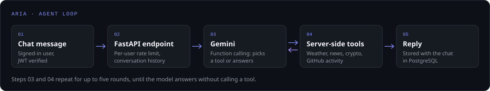
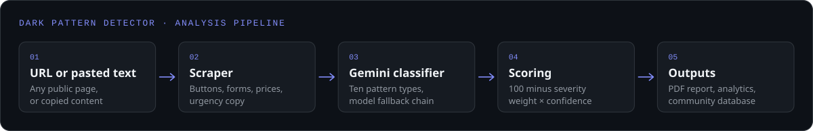
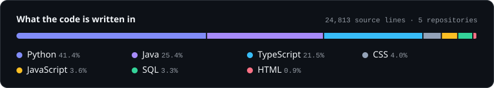

<h1 align="center">
  <picture>
    <source media="(prefers-color-scheme: dark) and (max-width: 640px)" srcset="https://raw.githubusercontent.com/niranjan4560/niranjan4560/main/assets/hero-dark-mobile.svg">
    <source media="(prefers-color-scheme: light) and (max-width: 640px)" srcset="https://raw.githubusercontent.com/niranjan4560/niranjan4560/main/assets/hero-light-mobile.svg">
    <source media="(prefers-color-scheme: dark)" srcset="https://raw.githubusercontent.com/niranjan4560/niranjan4560/main/assets/hero-dark.svg">
    <source media="(prefers-color-scheme: light)" srcset="https://raw.githubusercontent.com/niranjan4560/niranjan4560/main/assets/hero-light.svg">
    
  </picture>
</h1>

  <a href="https://www.linkedin.com/in/niranjan-n-s/"><b>LinkedIn</b></a>
  &nbsp;·&nbsp;
  <a href="https://leetcode.com/u/njn1171/"><b>LeetCode</b></a>
  &nbsp;·&nbsp;
  <a href="mailto:njn1171@gmail.com"><b>njn1171@gmail.com</b></a>
  &nbsp;·&nbsp;
  Kerala,&nbsp;India

## About

I'm a Computer Science and Engineering undergraduate at Amrita Vishwa Vidyapeetham. Most of what I build sits where AI meets software engineering: an LLM agent that calls real tools, a reinforcement-learning controller wrapped in a safety layer, an analytics platform that refuses to show a metric its data cannot support.

I care about the work that starts once a model trains: serving it behind an API, storing what it predicts, testing it, and reporting results as they are, including the ones that lose to a baseline.

**Open to** software engineering and AI/ML internships, and graduate software engineering roles.

## Featured engineering work

### [PlantPulse](https://github.com/niranjan4560/plantpulse) · Industrial operations intelligence platform

<code>Java 21</code> <code>Spring Boot 3</code> <code>PostgreSQL</code> <code>Flyway</code> <code>React 18</code> <code>TypeScript</code> <code>FastAPI</code> <code>scikit-learn</code> <code>Docker</code>

- **Problem.** Plant quality and maintenance records are usually too sparse for the KPIs a dashboard wants to show, so the gaps get filled with numbers nobody can defend.
- **Built.** A three-service platform: a Spring Boot API with JWT auth and role-based access, a PostgreSQL schema under Flyway migrations, a React and TypeScript front end with 24 working modules, and a FastAPI service for failure-risk, anomaly and forecast models.
- **Engineering highlight.** Every metric carries its origin and formula, and the API declines to compute what the records cannot support: no control limits under 20 subgroups, no Cpk on unconfirmed spec limits, no MTBF without operating hours. Model cards report held-out results against naive baselines, including the forecast that does not beat one.
- **Quality.** Unit, integration (real PostgreSQL), front-end and Playwright end-to-end suites, with [architecture](https://github.com/niranjan4560/plantpulse/blob/main/docs/ARCHITECTURE.md), [data](https://github.com/niranjan4560/plantpulse/blob/main/docs/DATA.md) and [testing](https://github.com/niranjan4560/plantpulse/blob/main/docs/TESTING.md) docs.

Developed with AI pair programming (Claude Code). The demo plant is synthetic and labelled as such throughout the UI.

### [Smart Classroom Energy Management](https://github.com/niranjan4560/IOT_PROJECT_TEAM1) · IoT and deep reinforcement learning

<code>Python</code> <code>PyTorch</code> <code>Dueling DQN</code> <code>LSTM</code> <code>MQTT</code> <code>Node-RED</code> <code>SQLite</code> <code>pytest</code>

- **Problem.** Classroom lighting and air conditioning run on timetables, not on whether anyone is in the room.
- **Built.** A five-person university project. Real sensor data from the ROBOD dataset is replayed over an authenticated MQTT broker; Node-RED validates and stores each reading; a Python service runs six occupancy models; a decision engine sends commands back to simulated actuators that acknowledge them.
- **My part.** The decision engine and the Dueling DQN air-conditioning controller, plus the energy and comfort evaluation (shared with a teammate).
- **Engineering highlight.** In closed-loop simulation the DQN with a safety layer used 63% less cooling energy than the rule-based controller, but left 7% of occupied time outside the comfort band against 0.6% for rules. We kept rules as the default and shipped the DQN as an advisory mode. All savings are reported as simulated.
- **Quality.** 86 tests covering flows, failure modes and an end-to-end loopback, with a [final report](https://github.com/niranjan4560/IOT_PROJECT_TEAM1/blob/main/deliverables/REPORT/Smart_Classroom_Final_Report.pdf).

### [ARIA](https://github.com/niranjan4560/ai-agent-dashboard) · AI agent dashboard with tool calling

<code>Python</code> <code>FastAPI</code> <code>Gemini function calling</code> <code>PostgreSQL</code> <code>SQLAlchemy</code> <code>JWT</code> <code>GitHub Actions</code>

<a href="https://github.com/niranjan4560/ai-agent-dashboard">
  <picture>
    <source media="(prefers-color-scheme: dark) and (max-width: 640px)" srcset="https://raw.githubusercontent.com/niranjan4560/niranjan4560/main/assets/aria-agent-loop-dark-mobile.svg">
    <source media="(prefers-color-scheme: light) and (max-width: 640px)" srcset="https://raw.githubusercontent.com/niranjan4560/niranjan4560/main/assets/aria-agent-loop-light-mobile.svg">
    <source media="(prefers-color-scheme: dark)" srcset="https://raw.githubusercontent.com/niranjan4560/niranjan4560/main/assets/aria-agent-loop-dark.svg">
    <source media="(prefers-color-scheme: light)" srcset="https://raw.githubusercontent.com/niranjan4560/niranjan4560/main/assets/aria-agent-loop-light.svg">
    
  </picture>
</a>

- **Problem.** Weather, news, markets, GitHub activity and a task list live in separate tabs, and most chat assistants can talk about them but not act on them.
- **Built.** A single-page dashboard with a FastAPI back end. The assistant runs an agentic loop of up to five rounds, choosing among weather, news, crypto and GitHub tools. Task commands such as "add" and "show my tasks" are handled directly by the back end and persist per user in PostgreSQL.
- **Engineering highlight.** Tool calls execute on the server, so API keys never reach the browser. Accounts use bcrypt and expiring JWTs with per-user data isolation, and chat is rate-limited per user. Widgets report an unconfigured provider instead of showing placeholder data.
- **Quality.** 33 pytest cases with external APIs and the LLM faked at the boundary; CI runs them on PostgreSQL 16 and SQLite.

### [Dark Pattern Detector](https://github.com/niranjan4560/dark-pattern-detector) · LLM analysis of manipulative UI design

<code>Python</code> <code>FastAPI</code> <code>Gemini</code> <code>BeautifulSoup</code> <code>PostgreSQL</code> <code>Streamlit</code> <code>Docker Compose</code>

<a href="https://github.com/niranjan4560/dark-pattern-detector">
  <picture>
    <source media="(prefers-color-scheme: dark) and (max-width: 640px)" srcset="https://raw.githubusercontent.com/niranjan4560/niranjan4560/main/assets/dark-pattern-pipeline-dark-mobile.svg">
    <source media="(prefers-color-scheme: light) and (max-width: 640px)" srcset="https://raw.githubusercontent.com/niranjan4560/niranjan4560/main/assets/dark-pattern-pipeline-light-mobile.svg">
    <source media="(prefers-color-scheme: dark)" srcset="https://raw.githubusercontent.com/niranjan4560/niranjan4560/main/assets/dark-pattern-pipeline-dark.svg">
    <source media="(prefers-color-scheme: light)" srcset="https://raw.githubusercontent.com/niranjan4560/niranjan4560/main/assets/dark-pattern-pipeline-light.svg">
    
  </picture>
</a>

- **Problem.** Fake urgency, hidden fees and pre-ticked boxes cost people money, and most people cannot name what they are looking at.
- **Built.** Paste a URL or page text; a scraper extracts the high-signal elements (buttons, forms, prices, urgency copy) and an LLM classifies ten dark-pattern types. Results feed PDF reports, a community report database and an analytics dashboard.
- **Engineering highlight.** A transparent 0–100 credibility score: each finding deducts a severity weight scaled by model confidence. A model fallback chain keeps analysis working when a model version is retired.
- **Demo.** [Live app](https://dark-pattern-detector-1-66q6.onrender.com) · [API docs](https://dark-pattern-detector-dz53.onrender.com/docs) (free tier, allow about a minute for a cold start)

### More

| Project | What it shows |
|---|---|
| [Disease Prediction System](https://github.com/niranjan4560/Disease-Prediction-System) | Classical ML pipeline on synthetic Pima-style patient data: four models compared, XGBoost served through FastAPI, SHAP explanations, Streamlit front end |
| [RepVault](https://github.com/niranjan4560/repvault-fitness-tracker) | Fitness tracker for workouts, nutrition and goals, built with Next.js, TypeScript and Firebase |
| [Message of the Day Dashboard](https://github.com/niranjan4560/docker_message_of_the_day_dashboard) | Flask API and Nginx front end, containerised and orchestrated with Docker Compose |

## Technical capabilities

Everything in this table is used in a repository above.

| Area | Used in projects |
|---|---|
| **Languages** | `Python` `Java` `TypeScript` `JavaScript` `SQL` |
| **AI / machine learning** | `PyTorch` `scikit-learn` `XGBoost` `LightGBM` `SHAP` `Reinforcement learning (DQN)` `LSTM` `LLM tool calling` |
| **Backend** | `FastAPI` `Spring Boot` `SQLAlchemy` `REST APIs` `JWT auth` `MQTT` |
| **Frontend** | `React` `Next.js` `Tailwind CSS` `Streamlit` `HTML` `CSS` |
| **Databases** | `PostgreSQL` `SQLite` `Firebase` |
| **Tools and platforms** | `Git` `Docker` `GitHub Actions` `pytest` `Playwright` `Node-RED` `Render` |

Also studied, not yet shown in a public repository: C, Haskell, MySQL, Bootstrap, Power BI.

## GitHub activity

<picture>
  <source media="(prefers-color-scheme: dark) and (max-width: 640px)" srcset="https://raw.githubusercontent.com/niranjan4560/niranjan4560/main/assets/languages-dark-mobile.svg">
  <source media="(prefers-color-scheme: light) and (max-width: 640px)" srcset="https://raw.githubusercontent.com/niranjan4560/niranjan4560/main/assets/languages-light-mobile.svg">
  <source media="(prefers-color-scheme: dark)" srcset="https://raw.githubusercontent.com/niranjan4560/niranjan4560/main/assets/languages-dark.svg">
  <source media="(prefers-color-scheme: light)" srcset="https://raw.githubusercontent.com/niranjan4560/niranjan4560/main/assets/languages-light.svg">
  
</picture>

Counted from tracked source files in PlantPulse, Smart Classroom, ARIA, Dark Pattern Detector and Disease Prediction System, November 2026. Lock files, generated code and data are excluded.

## Current focus

- **Agentic LLM applications.** Tool calling, server-side execution and guardrails, building on ARIA and the PlantPulse assistant.
- **Reinforcement learning under constraints.** Getting a learned controller to respect comfort and safety limits, following the Smart Classroom results.
- **Backend depth.** Authentication, schema migrations and integration testing in FastAPI and Spring Boot.
- **Data structures and algorithms.** Regular practice on [LeetCode](https://leetcode.com/u/njn1171/).

## Contact

I'm glad to talk about internships, projects or anything in these repositories.

| | |
|---|---|
| **LinkedIn** | [linkedin.com/in/niranjan-n-s](https://www.linkedin.com/in/niranjan-n-s/) |
| **Email** | [njn1171@gmail.com](mailto:njn1171@gmail.com) |
| **GitHub** | [github.com/niranjan4560](https://github.com/niranjan4560) |
| **LeetCode** | [leetcode.com/u/njn1171](https://leetcode.com/u/njn1171/) |
